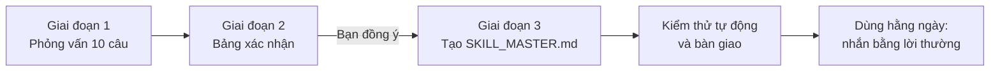

# 🎓 Academic Skill Master

> Bộ trợ lý AI riêng cho đồ án, khóa luận, tiểu luận của sinh viên Việt Nam, thuộc **mọi ngành**.

[](LICENSE)


**Academic Skill Master** là một *skill* (bộ kỹ năng) cho trợ lý AI, dùng được trên **Claude** (web, app, Claude Code), **Codex** của OpenAI và **Cursor**. Skill viết theo chuẩn mở Agent Skills (một thư mục có file `SKILL.md`), nên cùng một bộ file chạy được ở nhiều nơi. Nó phỏng vấn bạn 10 câu về đồ án, rồi tạo ra **một file trợ lý riêng** (`SKILL_MASTER.md`) bám sát **template trình bày** và **tiêu chí chấm điểm thật** của giảng viên bạn.

Sau đó, bạn chỉ cần nhắn bằng lời thường như *"giúp mình viết dàn ý chương 2"*, *"kiểm tra định dạng"*, *"bảo vệ thử với mình"*. Không cần nhớ lệnh, không cần biết kỹ thuật.

---

## Mục lục

- [Dành cho ai?](#dành-cho-ai)
- [Tính năng](#tính-năng)
- [Cách hoạt động](#cách-hoạt-động)
- [Cài đặt](#cài-đặt)
  - [Claude Code (app Claude trên máy tính hoặc terminal)](#a-claude-code)
  - [Claude.ai (trang web hoặc app điện thoại)](#b-claudeai-trang-web-hoặc-app)
  - [Codex của OpenAI](#c-codex-của-openai)
  - [Cursor](#d-cursor)
- [Cách dùng](#cách-dùng)
- [Bộ trợ lý được tạo ra gồm những gì?](#bộ-trợ-lý-được-tạo-ra-gồm-những-gì)
- [Những câu bạn có thể nhắn](#những-câu-bạn-có-thể-nhắn)
- [Cấu trúc thư mục](#cấu-trúc-thư-mục)
- [Liêm chính học thuật và giới hạn](#liêm-chính-học-thuật-và-giới-hạn)
- [Câu hỏi thường gặp](#câu-hỏi-thường-gặp)
- [Đóng góp](#đóng-góp)
- [Giấy phép](#giấy-phép)

---

## Dành cho ai?

- Sinh viên làm **đồ án môn học, đồ án tốt nghiệp, khóa luận, tiểu luận, dự án nhóm**.
- **Mọi ngành:** CNTT, Marketing, Kinh tế – Tài chính, Kỹ thuật, Thiết kế, Ngôn ngữ, Y – Dược, Luật, Giáo dục…
- Làm **một mình** hoặc **theo nhóm**.
- **Không cần biết kỹ thuật.** Mọi thứ đều nói chuyện bằng tiếng Việt đời thường.

## Tính năng

| Nhóm | Bộ trợ lý làm được gì |
|---|---|
| 📅 Lập kế hoạch | Mốc thời gian từ deadline thật, có mốc đệm 10–15%, mỗi mốc có điều kiện hoàn thành đo được |
| 💡 Đề tài và đề cương | Kiểm tra khả thi (thời gian, dữ liệu, phạm vi, điểm khác biệt), xác định mục tiêu đo được |
| 📝 Báo cáo | Khung báo cáo đầy đủ theo template trường, dàn ý từng chương, bản nháp có đánh dấu `[CẦN NGUỒN]`, `[CẦN BỔ SUNG SỐ LIỆU]` |
| 🔗 Logic xuyên suốt | Bảng *Mục tiêu → Phương pháp → Kết quả → Kết luận*, báo ngay mục tiêu nào chưa có kết quả |
| 📐 Định dạng | Khóa thông số trình bày (font, lề, phân cấp, phân trang, hình, bảng, công thức), kiểm lỗi kèm vị trí |
| 📚 Trích dẫn | Danh mục nguồn theo APA / IEEE / Harvard…, trạng thái *Đã xác minh / Chưa xác minh*, kiểm khớp hai chiều |
| 👥 Làm nhóm | Bảng phân công, review chéo, nhật ký đóng góp, cảnh báo quá tải và trễ hạn |
| 🧑‍🏫 Góp ý giảng viên | Nhật ký góp ý, kiểm tra đã xử lý hết trước khi nộp |
| 🖥️ Sản phẩm và demo | Chuỗi giai đoạn theo ngành, kịch bản demo, phương án dự phòng |
| 🎤 Slide và bảo vệ | Dàn slide theo thời lượng, câu hỏi phản biện dự đoán, **bảo vệ thử** (AI đóng vai hội đồng) |
| ✅ Chấm thử | Chấm theo rubric thật (hoặc rubric mặc định có gắn nhãn), chỉ ra điểm yếu đáng sửa nhất |
| 🚦 Rà soát cuối | Cổng chất lượng trước khi nộp: nội dung, nhất quán, định dạng, nguồn, liêm chính, tên file |

## Cách hoạt động



1. **Phỏng vấn.** Claude hỏi 10 câu trong một tin nhắn, chia 4 nhóm: thông tin chung, quy định và chấm điểm, nội dung và sản phẩm, tiến độ và quy định AI. Câu nào chưa biết cứ trả lời *"chưa biết"*, Claude sẽ gợi ý. Bạn có thể gửi kèm file mẫu báo cáo (.docx, .pdf), ảnh chụp quy định hoặc phiếu chấm.
2. **Xác nhận.** Claude tóm tắt thành một bảng, ghi rõ nguồn của từng thông tin (*từ template / từ bạn khai / giả định – chưa xác minh*). Chỉ khi bạn đồng ý mới tạo file.
3. **Tạo trợ lý.** Claude viết `SKILL_MASTER.md` gồm 5 phần, kèm 3 file phụ (`REFERENCES.md`, `PROJECT_STATUS.md`, `FEEDBACK_LOG.md`), tự kiểm tra bằng script, chạy thử vài yêu cầu mẫu, rồi hướng dẫn bạn đặt file đúng chỗ.

---

## Cài đặt

Chọn đúng nơi bạn đang dùng Claude. Không chắc thì dùng [cách B (Claude.ai)](#b-claudeai-trang-web-hoặc-app) – đơn giản nhất.

### A. Claude Code

Áp dụng cho **tab Code trong app Claude trên máy tính**, Claude Code trong terminal, hoặc trong VS Code / JetBrains.

**Cách 1 – Cài như plugin (khuyên dùng).** Trong ô chat của Claude Code, gõ lần lượt hai dòng:

```text
/plugin marketplace add namhocai/academic-skill-master
```

```text
/plugin install academic-skill-master@academic-skill-master
```

Khởi động lại phiên là dùng được.

**Cách 2 – Chạy script cài đặt.** Tải repo về (nút xanh **Code → Download ZIP** trên GitHub, rồi giải nén), mở thư mục vừa giải nén:

- Windows: chuột phải `install.ps1` → **Run with PowerShell**.
- macOS / Linux: mở Terminal trong thư mục đó và chạy:

```bash
bash install.sh
```

Script sẽ chép skill vào `~/.claude/skills/academic-skill-master/` (cho Claude Code) và `~/.agents/skills/academic-skill-master/` (cho Codex), dùng được cho mọi dự án.

**Cách 3 – Chép tay.** Chép cả thư mục `skills/academic-skill-master/` vào:

| Phạm vi | Đặt vào |
|---|---|
| Mọi dự án trên máy | `~/.claude/skills/academic-skill-master/` (Windows: `C:\Users\<tên>\.claude\skills\academic-skill-master\`) |
| Chỉ một thư mục đồ án | `<thư mục đồ án>/.claude/skills/academic-skill-master/` |

Thư mục đích phải chứa trực tiếp file `SKILL.md`.

### B. Claude.ai (trang web hoặc app)

**Cách 1 – Tải skill lên (nếu tài khoản của bạn có mục Skills):**

1. Tải file [`dist/academic-skill-master.zip`](dist/academic-skill-master.zip) về máy (bấm vào file rồi bấm nút **Download**). **Không giải nén.**
2. Mở [claude.ai](https://claude.ai), bấm vào tên bạn ở góc dưới bên trái → **Settings** → **Capabilities**.
3. Bật **Code execution and file creation** nếu chưa bật.
4. Ở mục **Skills**, bấm **Upload skill** và chọn file zip vừa tải.
5. Bật công tắc của skill `academic-skill-master`.

**Cách 2 – Dùng Project (nếu không thấy mục Skills):**

1. Mở claude.ai → **Projects** → **Create project**, đặt tên ví dụ "Trợ lý đồ án".
2. Trong Project, ở mục **Project knowledge**, bấm **+** và tải lên toàn bộ file trong thư mục `skills/academic-skill-master/` (gồm `SKILL.md` và các file trong `references/`, `assets/`).
3. Ở mục **Instructions** của Project, dán dòng: *"Làm theo SKILL.md trong Project knowledge."*

> Sau khi trợ lý riêng được tạo xong, Claude sẽ hướng dẫn bạn tạo **một Project mới cho đồ án** và tải file `SKILL_MASTER.md` vào đó.

### C. Codex của OpenAI

Áp dụng cho Codex CLI (dòng lệnh), app Codex và tiện ích Codex trong VS Code.

**Cách 1 – Chạy script cài đặt.** Giống [cách 2 của Claude Code](#a-claude-code): tải repo về, giải nén, chạy `install.ps1` (Windows) hoặc `install.sh` (macOS / Linux). Script cài cho cả Claude Code và Codex cùng lúc.

**Cách 2 – Chép tay.** Chép cả thư mục `skills/academic-skill-master/` vào:

| Phạm vi | Đặt vào |
|---|---|
| Mọi dự án trên máy | `~/.agents/skills/academic-skill-master/` (Windows: `C:\Users\<tên>\.agents\skills\academic-skill-master\`) |
| Chỉ một thư mục đồ án | `<thư mục đồ án>/.agents/skills/academic-skill-master/` |

Mở lại Codex nếu chưa thấy skill. Sau đó:

- Nhắn bình thường, ví dụ *"tạo trợ lý cho đồ án của mình"*, và Codex tự chọn skill; hoặc
- Gõ `$academic-skill-master` để gọi thẳng, hay gõ `/skills` để chọn từ danh sách.

> Bản Codex cũ dùng thư mục `~/.codex/skills/`. Nếu Codex của bạn không nhận skill ở `~/.agents/skills/`, hãy cập nhật Codex hoặc chép thêm vào `~/.codex/skills/`.

Trợ lý riêng cho đồ án sẽ được tạo tại `.agents/skills/do-an-<tên-ngắn>/SKILL.md` trong thư mục đồ án.

### D. Cursor

1. Tải repo về và giải nén.
2. Trong thư mục đồ án của bạn, tạo thư mục `.cursor/rules/` (nếu chưa có).
3. Chép file `skills/academic-skill-master/SKILL.md` vào đó và đổi tên thành `academic-skill-master.mdc`.
4. Chép thêm thư mục `references/` và `assets/` vào `.cursor/rules/academic-skill-master/` để Cursor đọc được khi cần.

---

## Cách dùng

Sau khi cài, bạn chỉ cần nhắn một câu như:

> *"Tạo trợ lý cho đồ án của mình"*
> *"Mình mới nhận đề tài khóa luận, giúp mình từ đầu"*
> *"Làm skill cho đồ án nhóm mình"*

Claude sẽ chào và gửi 10 câu hỏi. Ví dụ đoạn mở đầu:

```text
Chào bạn! Mình sẽ hỏi bạn 10 câu để làm riêng một bộ trợ lý cho đồ án của bạn.
Câu nào chưa biết cứ trả lời "chưa biết", mình sẽ gợi ý. Các câu 3, 4 và 8 là quan trọng nhất.

Nhóm A – Thông tin chung
1. Bạn học ngành gì, trường nào, khoa nào? ...
```

**Mẹo để có trợ lý tốt nhất:**

- Gửi **file mẫu báo cáo** của trường (câu 3) – Claude sẽ tự đọc font, lề, cách đánh số.
- Gửi **phiếu chấm / rubric** (câu 4) – trợ lý sẽ chia công sức theo đúng trọng số điểm.
- Ghi đủ **các mốc thời gian** (câu 8) – kế hoạch sẽ có mốc đệm trước mỗi hạn.

Kết quả: trên Claude Code, file được tạo sẵn tại `.claude/skills/do-an-<tên-ngắn>/SKILL.md` trong thư mục đồ án; trên Codex là `.agents/skills/do-an-<tên-ngắn>/SKILL.md`. Trên Claude.ai, bạn nhận file `SKILL_MASTER.md` để tải vào Project.

---

## Bộ trợ lý được tạo ra gồm những gì?

`SKILL_MASTER.md` luôn có đúng 5 phần:

| Phần | Nội dung chính |
|---|---|
| **1. Core Architecture & Domain Protocol** | Mốc thời gian; đề tài và đề cương; khung báo cáo từng chương kèm checklist; bảng logic xuyên suốt; chuỗi sản phẩm theo ngành; chiến lược theo rubric; slide và bảo vệ; cổng chất lượng trước khi nộp |
| **2. Template Enforcement & Styling Rules** | Thông số trình bày bị "khóa": chữ, trang, phân trang, phân cấp đề mục, hình, bảng, công thức, mã nguồn, danh sách, phần đầu và cuối. **Mỗi thông số đều ghi nguồn** |
| **3. Autonomous Citation Engine** | Chuẩn trích dẫn của trường, trạng thái xác minh từng nguồn, kiểm khớp hai chiều, quy tắc ghi nguồn phần mềm / dataset / ảnh |
| **4. Adaptive Collaboration Matrix** | Chế độ cá nhân hoặc nhóm, phân công, review chéo, nhật ký góp ý giảng viên, bảng rủi ro và sao lưu |
| **5. Natural-Language Intent Router** | Bảng hiểu ý: hơn 20 hành động, mỗi hành động có ít nhất 3 cách nói tự nhiên |

Ba file phụ đi kèm (khi môi trường cho phép ghi file):

| File | Dùng để |
|---|---|
| `PROJECT_STATUS.md` | Ghi nhớ tiến độ giữa các buổi làm việc |
| `REFERENCES.md` | Danh mục tài liệu tham khảo kèm trạng thái xác minh |
| `FEEDBACK_LOG.md` | Nhật ký góp ý của giảng viên và trạng thái đã sửa |

## Những câu bạn có thể nhắn

Sau khi có trợ lý riêng, bạn chỉ cần nói tự nhiên. Một vài ví dụ:

| Bạn nói | Trợ lý làm |
|---|---|
| "mình đang ở đâu rồi" | Bảng tiến độ: đã xong, đang làm, việc kế tiếp, rủi ro |
| "chương 2 nên viết gì" | Dàn ý chi tiết theo khung báo cáo |
| "soạn nháp phần 3.2" | Bản nháp có đánh dấu chỗ cần số liệu, cần nguồn + tóm tắt ý chính |
| "kiểm tra định dạng" | Danh sách lỗi kèm vị trí, hỏi bạn có muốn sửa luôn không |
| "thêm nguồn này: ..." | Ghi vào danh mục theo đúng chuẩn, báo trạng thái xác minh |
| "Lan làm chương 3, Minh duyệt" | Cập nhật bảng phân công, cảnh báo nếu ai quá tải |
| "thầy vừa góp ý phải thêm so sánh" | Ghi vào nhật ký góp ý, giao người xử lý |
| "làm slide cho 15 phút" | Dàn slide và lời nói theo thời lượng, chia phần cho từng người |
| "bảo vệ thử với mình" | Đóng vai hội đồng, hỏi lần lượt, chấm và góp ý |
| "chấm thử xem được mấy điểm" | Chấm theo rubric, chỉ ra 3 điểm yếu đáng sửa nhất |
| "sắp nộp rồi, kiểm tra lại hết" | Chạy toàn bộ cổng chất lượng, kết luận Đạt / Chưa đạt |

Người quen dùng có thể gõ lối tắt như `/outline`, `/check-format`, `/mock-defense`, nhưng **không bắt buộc**.

---

## Cấu trúc thư mục

```text
academic-skill-master/
├── .claude-plugin/
│   ├── plugin.json              # Thông tin plugin cho Claude Code
│   └── marketplace.json         # Cho phép cài bằng /plugin marketplace add
├── skills/
│   └── academic-skill-master/   # ← Thư mục skill (chép thư mục này khi cài tay)
│       ├── SKILL.md             # Quy trình chính: 3 giai đoạn
│       ├── references/
│       │   ├── principles.md        # Giao tiếp, liêm chính, quy định AI, văn phong
│       │   ├── interview.md         # 10 câu hỏi và cách xử lý câu trả lời
│       │   ├── skill-master-spec.md # Đặc tả 5 section của SKILL_MASTER.md
│       │   ├── default-rubric.md    # Rubric mặc định (khi chưa có rubric thật)
│       │   └── intent-router.md     # Bảng hiểu ý và quy tắc hành vi
│       ├── assets/
│       │   ├── PROJECT_STATUS.md    # Mẫu file theo dõi tiến độ
│       │   ├── REFERENCES.md        # Mẫu danh mục tài liệu tham khảo
│       │   └── FEEDBACK_LOG.md      # Mẫu nhật ký góp ý
│       └── scripts/
│           └── validate_skill.py    # Kiểm tra tự động file SKILL_MASTER.md
├── dist/
│   └── academic-skill-master.zip    # Gói sẵn để tải lên Claude.ai
├── tools/
│   └── build_zip.py             # Tạo lại file zip trong dist/
├── install.ps1                  # Cài nhanh cho Claude Code + Codex trên Windows
├── install.sh                   # Cài nhanh cho Claude Code + Codex trên macOS / Linux
├── CHANGELOG.md
├── LICENSE
└── README.md
```

### Kiểm tra file trợ lý bằng script

Claude tự chạy bước này sau khi tạo file. Nếu muốn tự kiểm (cần Python 3):

```bash
python skills/academic-skill-master/scripts/validate_skill.py duong/dan/SKILL_MASTER.md --env web
```

Script kiểm tra: frontmatter hợp lệ, tên skill đúng quy tắc, mô tả không quá dài, đủ 5 section đúng thứ tự, dòng "LƯU Ý" ở đầu Section 1, mọi thông số ở Section 2 có ghi nguồn, không còn chỗ điền bị bỏ sót, độ dài phù hợp môi trường (`web`, `code`, `codex`, `cursor`).

---

## Liêm chính học thuật và giới hạn

Bộ trợ lý được thiết kế để **hỗ trợ**, không làm thay. **Bạn là người chịu trách nhiệm về bài của mình.**

- ❌ **Không bịa** số liệu khảo sát, kết quả chạy thử, nguồn tài liệu, DOI hay số trang.
- 🏷️ Mọi thông tin không lấy từ bạn hoặc từ template đều gắn nhãn **"giả định – CHƯA XÁC MINH"**.
- ✍️ Bản nháp luôn có đánh dấu `[CẦN BỔ SUNG SỐ LIỆU]`, `[CẦN NGUỒN]` để bạn tự hoàn thiện, kèm tóm tắt ý chính để bạn hiểu và trả lời được khi bảo vệ.
- 🤖 Tự điều chỉnh theo **quy định AI của trường**:

| Quy định của trường | Trợ lý sẽ |
|---|---|
| Cho phép, có khai báo | Hỗ trợ đầy đủ và soạn sẵn mẫu câu khai báo dùng AI |
| Hạn chế | Chỉ hỗ trợ ở những phần được phép |
| Cấm hoàn toàn | Chỉ góp ý, giải thích, kiểm tra lỗi – **không viết nháp thay bạn** |
| Chưa biết | Coi như cần khai báo, nhắc bạn hỏi lại giảng viên |

**Những điều trợ lý không làm được (và sẽ nói thật với bạn):**

- Không đếm chính xác số trang Word, không thấy ảnh mờ, bảng tràn lề, hình bị tách trang – bạn cần mở file kiểm lại.
- Không xác minh được nguồn nếu không có công cụ tìm kiếm web – mọi nguồn mặc định là "chưa xác minh".
- Không hứa hẹn điểm A+. Mục tiêu là bám sát tiêu chí chấm thật và loại bỏ lỗi có thể tránh được.

> ⚠️ Hãy luôn tự kiểm tra đạo văn và đọc kỹ quy chế sử dụng AI của trường/khoa trước khi nộp.

---

## Câu hỏi thường gặp

<details>
<summary><b>Mình không biết gì về lập trình, có dùng được không?</b></summary>

Được. Bạn chỉ cần nhắn bằng tiếng Việt bình thường. Nếu dùng Claude.ai, làm theo [cách B](#b-claudeai-trang-web-hoặc-app) là xong, không cần cài gì trên máy.
</details>

<details>
<summary><b>Dùng Codex hay ChatGPT thay cho Claude được không?</b></summary>

Codex: được, xem [cách C](#c-codex-của-openai). Skill viết theo chuẩn mở Agent Skills nên chép thư mục là dùng. Các công cụ khác cũng hỗ trợ chuẩn này thì thường cũng chạy được, nhưng repo mới kiểm tra hướng dẫn cho Claude, Codex và Cursor.
</details>

<details>
<summary><b>Mình chưa có file mẫu hay rubric của trường thì sao?</b></summary>

Cứ trả lời "chưa biết". Claude sẽ đề xuất chuẩn phổ biến của ngành và gắn nhãn "giả định – chưa xác minh". Khi có file thật, bạn gửi vào và nói "đây là file mẫu", trợ lý sẽ tự cập nhật.
</details>

<details>
<summary><b>Mình chưa có đề tài, dùng được không?</b></summary>

Được. Claude sẽ chạy bước kiểm tra khả thi (đủ thời gian, đủ dữ liệu, phạm vi vừa sức, khác biệt so với đồ án cũ) và đưa 2–3 hướng đề tài để bạn chọn.
</details>

<details>
<summary><b>Nhóm nhiều người thì dùng chung thế nào?</b></summary>

Một người tạo trợ lý rồi chia sẻ file `SKILL_MASTER.md` (hoặc chia sẻ Project trên Claude.ai nếu gói tài khoản hỗ trợ). Trợ lý có chế độ nhóm: phân công, review chéo, nhật ký đóng góp, và chia câu hỏi bảo vệ cho từng người.
</details>

<details>
<summary><b>Trợ lý có nhớ tiến độ giữa các lần chat không?</b></summary>

Trên Claude Code và Codex: có, lưu vào `PROJECT_STATUS.md`. Trên Claude.ai: cuối mỗi buổi, trợ lý đưa một đoạn "tóm tắt trạng thái" ngắn để bạn dán lại ở lần sau.
</details>

<details>
<summary><b>Thầy cô đổi yêu cầu giữa chừng thì sao?</b></summary>

Gửi quy định mới vào và nói "thầy đổi yêu cầu trình bày". Trợ lý cập nhật Section 2 và chỉ rõ những chỗ đã thay đổi.
</details>

<details>
<summary><b>Dùng skill này có bị coi là gian lận không?</b></summary>

Tùy quy định của trường. Skill được thiết kế theo hướng hỗ trợ minh bạch: không bịa dữ liệu, đánh dấu rõ chỗ cần bạn tự làm, soạn sẵn mẫu khai báo dùng AI, và chuyển sang chế độ chỉ góp ý nếu trường cấm. Hãy luôn đọc quy chế và hỏi giảng viên khi không chắc.
</details>

---

## Đóng góp

Mọi góp ý đều quý! Bạn có thể:

- Mở [Issue](https://github.com/namhocai/academic-skill-master/issues) để báo lỗi hoặc đề xuất tính năng.
- Gửi Pull Request: thêm chuỗi giai đoạn cho ngành mới, bổ sung chuẩn trình bày của trường, cải thiện câu hỏi phỏng vấn.

Sau khi sửa file trong `skills/academic-skill-master/`, chạy lệnh sau để cập nhật gói zip:

```bash
python tools/build_zip.py
```

## Giấy phép

Phát hành theo giấy phép [MIT](LICENSE). Bạn được tự do dùng, sửa và chia sẻ.

---

<p align="center">Làm với ❤️ cho sinh viên Việt Nam · <a href="https://github.com/namhocai">@namhocai</a></p>
